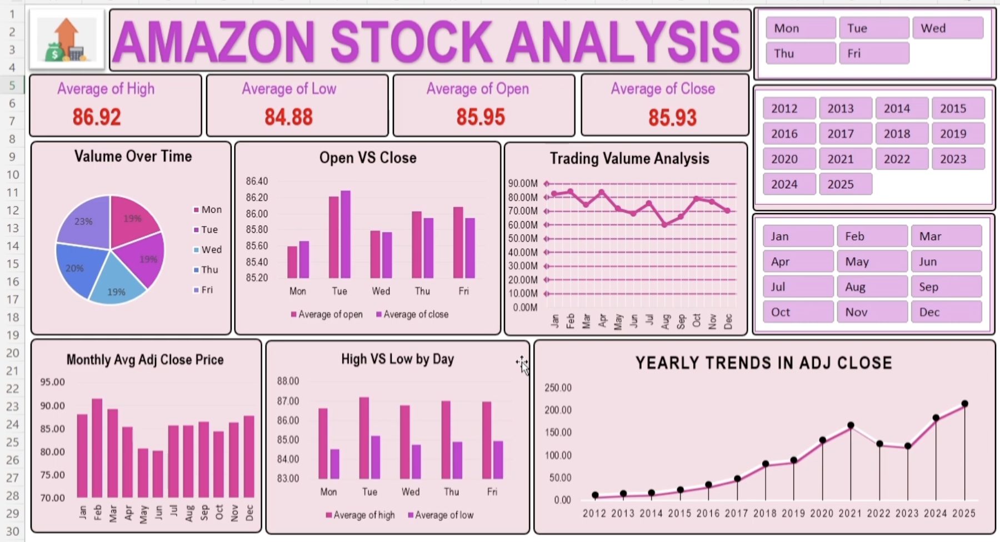

# amazon-stock-analysis-excel-dashboard
A quantitative financial case study and Excel dashboard analyzing Amazon's historical stock time-series data , focusing on volatility, moving averages, and market drawdowns

# 📈 Amazon Stock Analysis - Quantitative Case Study & Dashboard

## 📌 Project Overview
This project presents an in-depth quantitative case study and Excel-based dashboard analyzing historical time-series data for **Amazon.com, Inc. (AMZN)** spanning from its IPO era (May 1997) through Q3 2025. The analysis explores macro-economic cycles, trading volume dynamics, price volatility, and key technical indicators.

---

## 📊 Dashboard Preview

---

## 🎯 Key Performance Metrics & Summary
* **Average High Price:** $86.92
* **Average Low Price:** $84.88
* **Average Open Price:** $85.95
* **Average Close Price:** $85.93
* **Timeline Covered:** Over 7,000 trading sessions across multiple macroeconomic regimes

---

## 🔍 Core Problem Set & Analysis Areas
1. **Daily Return & Volatility Modeling:**
   - Evaluated log returns $r_t = \ln(P_t / P_{t-1})$ using adjusted closing prices.
   - Calculated annualized historical volatility across three distinct market epochs: Dot-Com Era, Post-Crisis Expansion, and Post-Pandemic/Rate Hiking Era.
2. **Moving Average Crossover Strategy Backtest:**
   - Implemented quantitative backtesting for dual moving averages (Fast SMA: 50 days, Slow SMA: 200 days) to evaluate trading signals.
   - Computed strategy returns and compared them against a Buy-and-Hold benchmark with an assumed risk-free rate ($r_f = 2.5\%$).
3. **Maximum Drawdown & Crisis Analysis:**
   - Identified peak-to-trough declines during major historical crashes (Dot-Com crash 2000-2001 and the 2022 macroeconomic correction).

---

## 🛠️ Tools & Technologies Used
* **Microsoft Excel:** Dashboard designing, Pivot Tables, conditional formatting, and visual charts.
* **Quantitative Finance Concepts:** Logarithmic returns, Annualized Volatility, Moving Averages (SMA), and Maximum Drawdown (MDD).
* **GitHub:** Version control and portfolio management.

---

## 📂 Repository Structure
* `Amazon_dataset.csv` - Historical daily stock dataset (Open, High, Low, Close, Adj Close, Volume).
* `AMZN Stock Analysis Problem Set.pdf` - Official problem set guidelines and analytical requirements.
* `Dashboard Screenshot` - Visual preview of the Excel dashboard.

---
